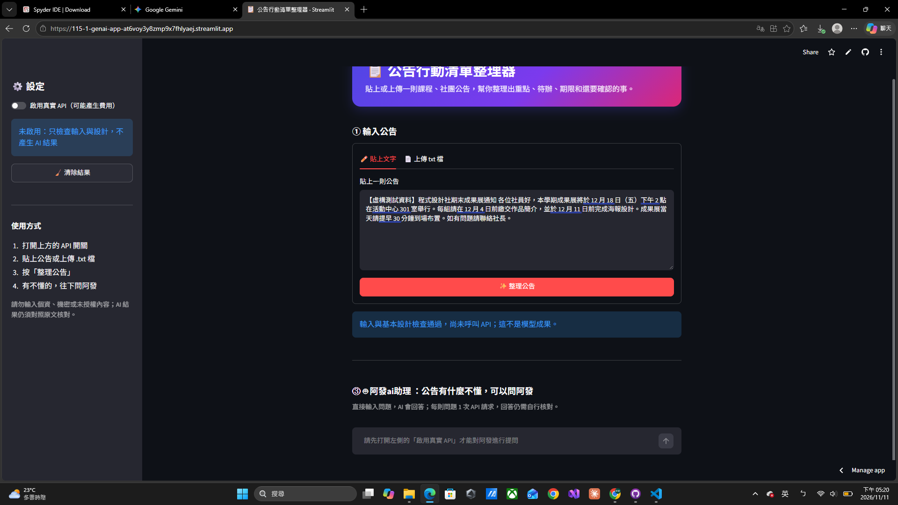
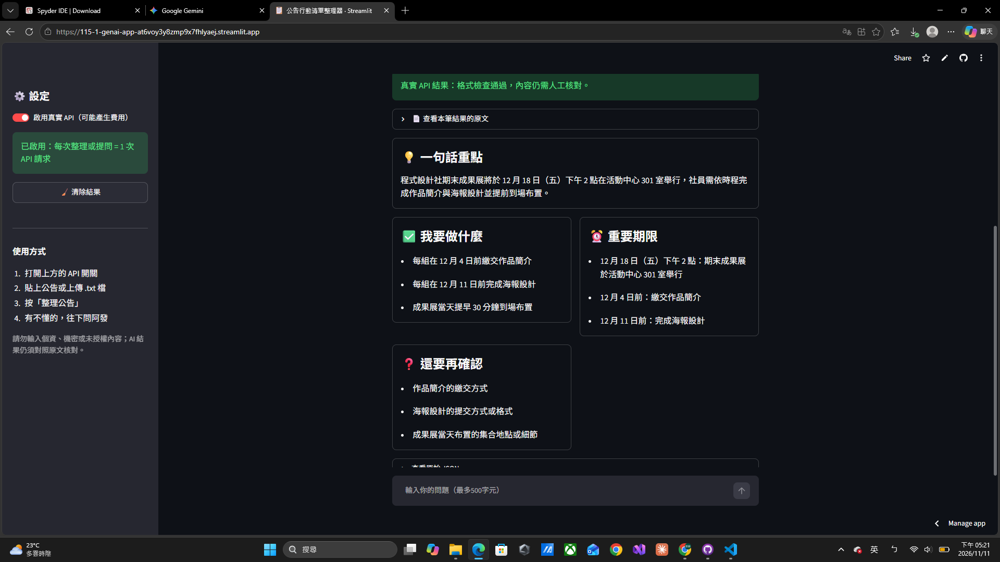
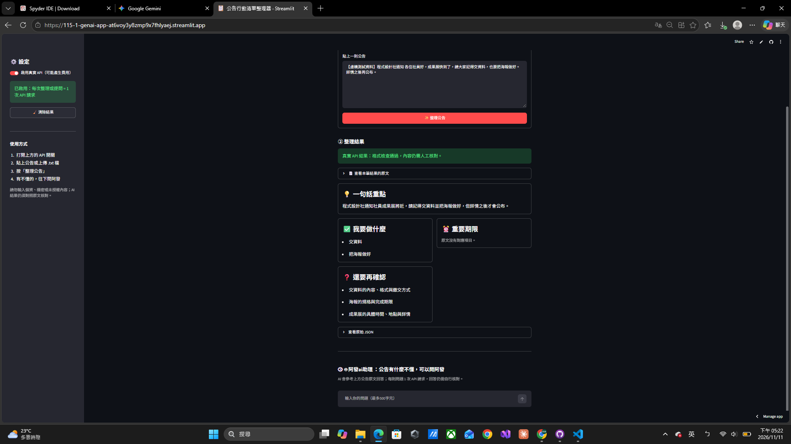
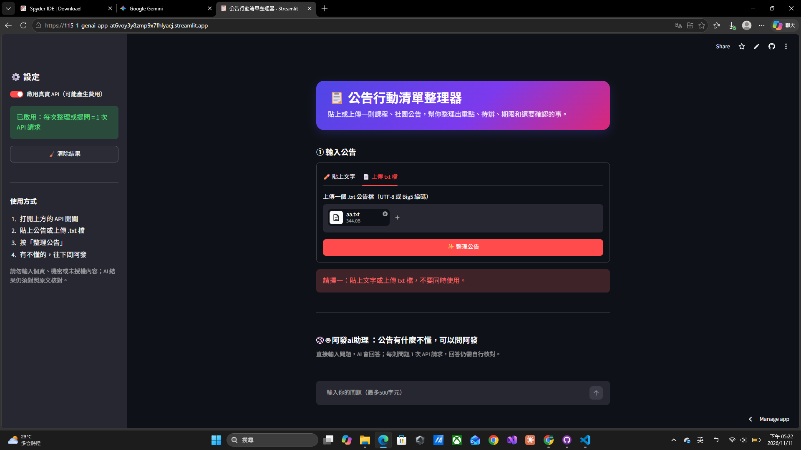
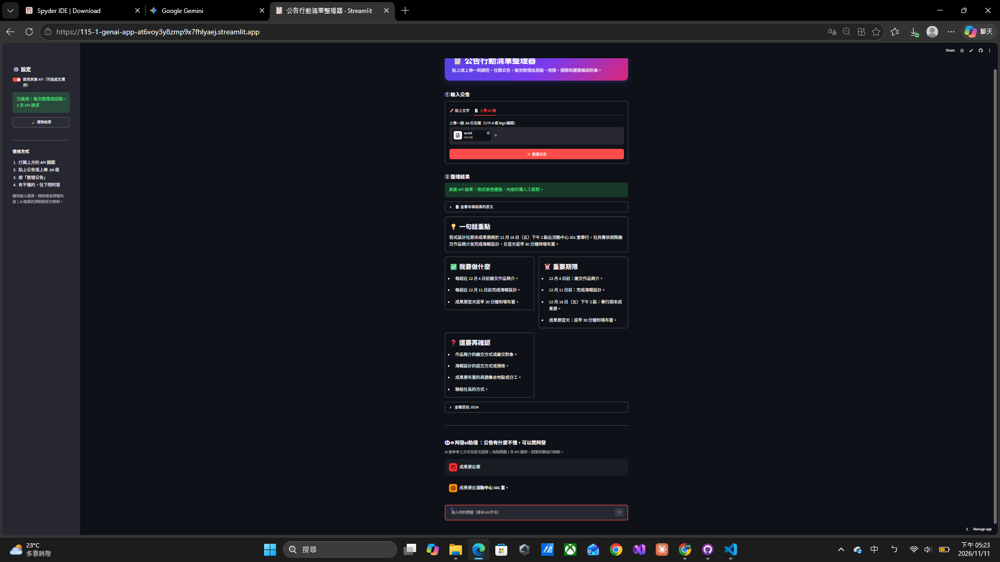
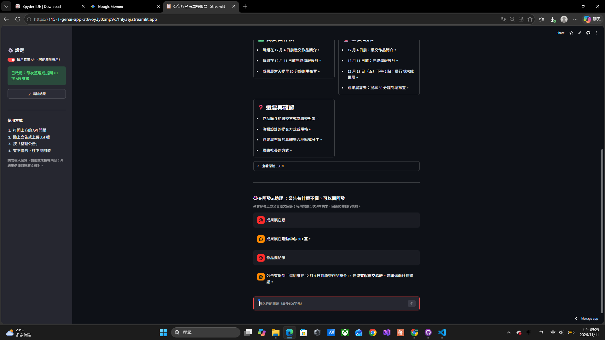

# 第 8 週｜個人專題設計與驗收紀錄

請複製後自行填寫。這是紀錄表，空白不代表通過；不可填入真實金鑰或個資。

## 一、自己的問題與設計

| 項目 | 我的內容 |
|---|---|
| App 名稱／作者 | 公告行動清單整理器／林祐嘉 |
| 目標使用者與情境 | 常收到課程或社團長公告的學生；公告內容多時，容易漏掉該做的事和期限 |
| 想完成的一個任務 | 把一則公告整理成一句話重點、待辦事項、重要期限和待確認事項 |
| 輸入資料與範圍 | 貼上一則公告文字，或上傳一個 .txt 檔（UTF-8 或 Big5 編碼、100 KB 以內），兩者擇一；內容最多 6000 字元；測試使用虛構公告，不輸入個資或機密內容 |
| 資訊不足如何處理 | 只依原文整理，不自行補造；一句話重點須說明資訊不足；原文沒寫但執行時需要的資訊，列在「還要再確認」；原文沒有待辦或期限時，對應欄位回傳空清單 |
| 採用 starter 或自行實作 | 採用 JSON Schema starter；主流程與檢查已提供，可以專注設計任務規則和輸出欄位 |
| 結構化輸出路線 | JSON Schema；本專題欄位都是文字或文字清單，starter 已支援，不需要另外定義 Pydantic 模型 |
| 相較教師範例的個人設計 | 教師範例整理筆記的標題、摘要與重點；本專題改為幫學生找出下一步行動。實際修改：重寫 APP_TITLE 與 INSTRUCTIONS；將 Schema 設計為 summary、action_items、deadlines、missing_info；修改欄位標籤、頁面說明、輸入框與按鈕文字；測試發現漏掉地點後，在 summary 規則加入時間與地點要求。延伸功能（2026-11-11 加入）：(1) 上傳 .txt 檔整理公告；(2)「阿發ai助理」問答，可直接提問，已整理公告時只依公告原文回答，原文沒寫就說「公告沒有提到」；(3) 介面美化：頁首橫幅、側邊欄設定、結果卡片 |

## 二、輸出欄位契約

至少兩個有用途的欄位；可自行加列。

| 欄位名稱 | 型別／限制 | 用途 | 畫面標籤 | 如何查原文 |
|---|---|---|---|---|
| summary | string；必填、非空 | 快速了解這則公告在說什麼 | 一句話重點 | 對照公告主旨與主要內容，確認沒有加入原文沒有的資訊 |
| action_items | array of string；必填，原文沒有待辦時可為空清單 | 列出學生需要做的事 | 我要做什麼 | 逐項找到原文對應的要求，確認沒有遺漏或自行新增 |
| deadlines | array of string；必填，原文沒有期限時可為空清單 | 列出原文寫明的日期、時間和對應事項 | 重要期限 | 逐項比對日期、時間和事項是否與原文相同，不自行推算 |
| missing_info | array of string；必填，資訊完整時可為空清單 | 列出原文沒寫、但執行待辦時需要確認的資訊 | 還要再確認 | 回到原文確認這些資訊真的沒有寫，而且確實會影響執行 |

## 三、測試紀錄

| 項目 | 實際輸入／操作 | 實際輸出／錯誤 | 人工判讀與修正 | 證據類型 |
|---|---|---|---|---|
| 空白 | API 關閉，以自動測試送出三個空白字元 | 顯示「請先輸入要處理的原文。」；0 次請求 | 正確擋下；雲端真人操作已測，0 次請求 | 離線（AppTest 自動測試）＋雲端真人操作 |
| 過長 | API 關閉，以自動測試送出 6001 字元；另測 6000 字元 | 6001 字元顯示「請縮短到 6000 字元以內；不會默默截斷原文。」；6000 字元通過輸入檢查；0 次請求 | 邊界正確；雲端真人操作已測，0 次請求 | 離線（AppTest 自動測試）＋雲端真人操作 |
| 正常資料（修正前） | 2026-11-05，本機，模型 gpt-5.4-mini，啟用 API 送出虛構公告：「【虛構測試資料】程式設計社期末成果展通知 各位社員好，本學期成果展將於 12 月 18 日（五）下午 2 點在活動中心 301 室舉行。每組請在 12 月 4 日前繳交作品簡介，並於 12 月 11 日前完成海報設計。成果展當天請提早 30 分鐘到場布置。如有問題請聯絡社長。」 | 一句話重點：程式設計社本學期成果展將於 12 月 18 日（五）下午 2 點舉行，社員需先完成作品簡介與海報設計，並於當天提早到場布置。／我要做什麼：每組在 12 月 4 日前繳交作品簡介；每組在 12 月 11 日前完成海報設計；成果展當天提早 30 分鐘到場布置。／重要期限：12 月 18 日（五）下午 2 點：成果展舉行；12 月 4 日前：繳交作品簡介；12 月 11 日前：完成海報設計。／還要再確認：作品簡介的繳交方式或繳交對象；海報設計的格式或提交方式；成果展當天布置的具體集合方式或分工安排。 | 待辦與期限都能對應原文，也沒有自行推算時間。問題：四個欄位都沒有地點「活動中心 301 室」。修正：在 summary 規則加入「原文有寫活動時間或地點時要包含」，再用同一則公告複測。實際請求數：1 次 | 本機真實 API |
| 正常資料（修正後） | 2026-11-05，Streamlit Community Cloud，模型 gpt-5.4-mini，啟用 API 送出與修正前相同的虛構公告 | 一句話重點：程式設計社本學期成果展將於 12 月 18 日（五）下午 2 點在活動中心 301 室舉行，社員需在指定期限前完成作品簡介與海報設計，並於當天提早到場布置。／我要做什麼：每組在 12 月 4 日前繳交作品簡介。；每組在 12 月 11 日前完成海報設計。；成果展當天提早 30 分鐘到場布置。／重要期限：12 月 18 日（五）下午 2 點：本學期成果展舉行。；12 月 4 日前：繳交作品簡介。；12 月 11 日前：完成海報設計。／還要再確認：作品簡介的繳交方式或繳交對象未說明。；海報設計的規格或提交方式未說明。；成果展當天布置的集合地點或詳細流程未說明。；聯絡社長的方式未說明。 | 修正有效：重點已包含地點「活動中心 301 室」。待辦與期限都能對應原文，也沒有自行推算時間。還要再確認的四項原文確實沒寫；「集合地點」與已知的活動地點略有重疊，影響不大。此結果只代表這一筆，不代表其他公告都正確。實際請求數：1 次 | 雲端真實 API |
| 資訊不足 | 2026-11-05，Streamlit Community Cloud，模型 gpt-5.4-mini，啟用 API 送出虛構公告：「【虛構測試資料】程式設計社通知 各位社員好，成果展快到了，請大家記得交資料，也要把海報做好。詳情之後再公布。」 | 一句話重點：程式設計社通知社員準備成果展，需交資料並完成海報，但詳細資訊之後才會公布。／我要做什麼：交資料；把海報做好。／重要期限：空清單，畫面顯示「原文沒有對應項目。」／還要再確認：交資料的內容、格式與繳交方式；海報的規格與完成標準；成果展的時間、地點與詳細安排。 | 沒有編造日期、地點或繳交方式，也沒有把「快到了」當成期限；缺少的資訊都列在還要再確認。此結果只代表這一筆。實際請求數：1 次 | 雲端真實 API |
| 結果保存／再送出失敗 | 以假回應模擬成功後重跑；再提交空白內容 | 重跑時保留結果且未新增請求；提交空白後舊結果清除並顯示錯誤 | 舊結果有清除；此項為模擬，不是模型成果 | 離線模擬（AppTest＋假回應） |
| 缺 key／服務失敗 | 環境沒有金鑰時啟用 API 並送出；另以假回應模擬缺欄位、多欄位、空白、型別錯誤、未完成、拒答與無效 JSON | 缺 key 顯示「缺少 OPENAI_API_KEY，請設定本機 .env 或平台 Secrets。」且 0 次請求；各種不合格回應都顯示錯誤且不保存 | 在請求前停止；實際服務故障未測 | 離線模擬（AppTest＋假回應） |
| Cloud 部署（必做） | 2026-11-05，App 網址 https://115-1-genai-app-at6voy3y8zmp9x7fhlyaej.streamlit.app/ ；部署 Repo／分支／入口：Lin10150409/115-1-genAI-App／main／Midterm Mini-Project/app.py；以無痕視窗開啟 App，啟用 API 送出上方「正常資料（修正後）」與「資訊不足」兩筆虛構公告 | 兩筆都成功，畫面顯示當筆原文與四個欄位結果，實際輸出見上方兩列；模型 gpt-5.4-mini；雲端實際請求數 2 次 | 部署成功，雲端介面可以操作。兩筆結果都逐欄對照原文，沒有編造資訊（核對內容見上方兩列）。無痕視窗可以開啟，老師本人是否能開啟待老師驗收 | 雲端真實 API |
| 延伸：上傳 txt（離線） | 2026-11-11，API 以假回應模擬，上傳 UTF-8、UTF-8（含 BOM）、Big5 三種編碼的 txt；另測同時貼上文字與上傳檔案、上傳超過 100 KB 的檔案 | 三種編碼都正確讀出文字並送去整理；同時使用時顯示「請擇一：貼上文字或上傳 txt 檔，不要同時使用。」；超過 100 KB 時顯示「檔案太大，請上傳 100 KB 以內的 txt 檔。」，兩者都是 0 次請求 | 讀檔與錯誤提示正確；此項為模擬，不是模型成果 | 離線模擬（AppTest＋假回應） |
| 延伸：阿發問答（離線） | 2026-11-11，API 以假回應模擬：未整理公告時直接提問；整理公告後再提問；按清除結果 | API 關閉時輸入框停用；未整理公告時只送出問題；整理後送出的內容包含公告原文；換新公告或按清除時，問答紀錄清空 | 流程正確；此項為模擬，不是模型成果 | 離線模擬（AppTest＋假回應） |
| 延伸：上傳 txt 整理公告（真實 API） | 2026-11-11，Streamlit Community Cloud，模型 gpt-5.4-mini，啟用 API，在「上傳 txt 檔」分頁上傳 `測試公告.txt`（UTF-8，內容與上方「正常資料」虛構公告相同），貼上文字分頁保持空白 | 一句話重點：程式設計社期末成果展將於 12 月 18 日（五）下午 2 點在活動中心 301 室舉行，社員需在指定期限前完成作品簡介與海報設計，並於當天提早到場布置。／我要做什麼：各組在 12 月 4 日前繳交作品簡介；各組在 12 月 11 日前完成海報設計；成果展當天提早 30 分鐘到場布置。／重要期限：12 月 18 日（五）下午 2 點：期末成果展；12 月 4 日前：繳交作品簡介；12 月 11 日前：完成海報設計。／還要再確認：作品簡介的繳交方式；作品簡介的繳交地點/對象；海報設計的提交方式；海報設計的提交地點/對象；成果展當天布置的具體集合地點。 | txt 檔正確讀取，結果與貼上文字的「正常資料（修正後）」幾乎相同。重點包含時間與地點；待辦與期限都能對應原文，沒有自行推算日期；還要再確認的項目原文確實沒寫，「集合地點」與已知的活動地點略有重疊，影響不大。此結果只代表這一筆。實際請求數：1 次 | 雲端真實 API |
| 延伸：問阿發公告有寫的事（真實 API） | 2026-11-11，Streamlit Community Cloud，模型 gpt-5.4-mini，接續 txt 整理結果，問「成果展在哪裡？」；截圖時以 txt 整理後再問一次「成果展在哪」 | 第一次回答原文未保存；截圖時的回答：「成果展在活動中心 301 室。」（見截圖 5） | 回答與原文的地點相同，沒有加入原文沒有的資訊。實際請求數：第一次 1 次，截圖時 1 次 | 雲端真實 API＋截圖 |
| 延伸：問阿發公告沒寫的事（真實 API） | 2026-11-11，Streamlit Community Cloud，模型 gpt-5.4-mini，接續上一題，問「作品簡介要用什麼方式繳交？」；截圖時接續截圖 5 的對話，改問「作品要給誰」 | 第一次回答原文未保存；截圖時的回答：「公告有提到『每組請在 12 月 4 日前繳交作品簡介』，但沒有說要交給誰。建議你向社長確認。」（見截圖 6） | 先引用原文有寫的部分，再明確說明原文沒寫繳交對象，沒有編造人名或方式，並建議向社長確認，符合規則。實際請求數：第一次 1 次，截圖時 1 次 | 雲端真實 API＋截圖 |

### 測試截圖（2026-11-11，Streamlit Community Cloud）

以下截圖皆在雲端網址 https://115-1-genai-app-at6voy3y8zmp9x7fhlyaej.streamlit.app/ 拍攝，畫面上方可看到網址。截圖 2、3、5 是拍照時重新送出的真實 API 結果，內容與上方表格的文字紀錄略有不同，屬於另一次執行。

**截圖 1：API 關閉時只做輸入檢查（0 次請求）**
API 開關關閉，貼上正常資料公告後按「整理公告」，只顯示「輸入與基本設計檢查通過，尚未呼叫 API；這不是模型成果。」，阿發的輸入框也是停用狀態。

**截圖 2：正常資料（真實 API）**
重點包含時間與地點「活動中心 301 室」；待辦 3 項、期限 3 項都能對應原文，沒有自行換算日期；還要再確認的 3 項原文確實沒寫。

**截圖 3：資訊不足（真實 API）**
重要期限顯示「原文沒有對應項目。」，沒有把「快到了」當成期限；繳交方式、海報規格、成果展時間地點都列在還要再確認，沒有編造。

**截圖 4：同時貼上文字與上傳檔案（0 次請求）**
貼上文字分頁有內容、又上傳 txt 檔時，顯示「請擇一：貼上文字或上傳 txt 檔，不要同時使用。」，在送出請求前停止。

**截圖 5：上傳 txt 整理公告＋問阿發公告有寫的事（真實 API）**
上傳內容為正常資料公告的 txt 檔（aa.txt），四個欄位都能對應原文。重要期限多列一項「成果展當天：提早 30 分鐘到場布置」，原文確實有這個要求，但它不是明確日期，歸在期限略有爭議。接著問阿發「成果展在哪」，回答「成果展在活動中心 301 室。」，與原文相同。

**截圖 6：問阿發公告沒寫的事（真實 API）**
接續截圖 5 的對話，問「作品要給誰」。阿發回答「公告有提到『每組請在 12 月 4 日前繳交作品簡介』，但沒有說要交給誰。建議你向社長確認。」先引用原文，再說明原文沒寫繳交對象，沒有編造。

## 四、環境、交付與反思

Python／Streamlit／OpenAI SDK／python-dotenv 實際版本：本機 Python 3.14.10／Streamlit 1.63.0／OpenAI SDK 2.49.0／python-dotenv 1.2.3。
GitHub：https://github.com/Lin10150409/115-1-genAI-App 。啟動方式：見 README。Streamlit Community Cloud部署網址（必填）：https://115-1-genai-app-at6voy3y8zmp9x7fhlyaej.streamlit.app/ 。
部署Repo／分支／入口：Lin10150409/115-1-genAI-App／main／Midterm Mini-Project/app.py。Cloud實際Python版本：3.14.10（來自部署 log，之後未更改）。驗收日期與結果：2026-11-05，雲端正常與資訊不足各一筆真實 API 成功，並逐欄核對。老師觀看權限確認：已用無痕視窗開啟 App；老師本人是否能開啟待老師驗收。
部署為必做；未部署或未通過者如實記錄錯誤與待補驗項目，依老師公告期限完成，不以本機截圖代替。
本次實際請求數／追加測試數：共 11 次。基本功能 3 次（本機 1 次、雲端 2 次），其中雲端的正常資料複測用於比較修正前後；延伸功能追加 3 次（雲端：上傳 txt 整理 1 次、阿發問答 2 次）；拍攝測試截圖時又追加 5 次（雲端：正常資料 1 次、資訊不足 1 次、上傳 txt 整理 1 次、問阿發 2 次）。截圖 1、4 為 API 關閉或輸入錯誤，0 次請求。阿發兩題的第一次回答原文未保存，但截圖時重問的回答已保存在截圖 5、6。尚未完成的驗證：老師本人開啟 App、實際服務故障（未測）、大量或不同類型公告（未測）、阿發回答與公告無關的問題（未測）。
AI 協助內容：使用 Claude Code 協助選題、草擬設計表、任務規則與 Schema、修改 app.py、撰寫離線測試、排查部署錯誤及起草 README；延伸功能（上傳 txt、阿發問答、介面美化）的程式與離線測試也由 Claude Code 協助撰寫。自己的修改與親自驗證：親自部署、操作本機與雲端真實 API 測試，並自行修改阿發ai助理的名稱與標題。
最有用的欄位：missing_info，能提醒公告沒寫但會影響執行的資訊。遇到的錯誤：(1) 第一次測試的四個欄位都沒有地點，修改 summary 規則後用同一則公告複測，地點有出現。(2) 資料夾名稱有空格，導致 Cloud 無法讀取同層的 requirements.txt；將該檔改名為 requirements-local.txt，讓 Cloud 改用 Repo 根目錄的 requirements.txt 後，部署成功。已知限制：一次處理一則公告（貼上文字或 .txt 檔），最多 6000 字元，不支援 PDF 或 Word；阿發問答每問一題就多 1 次請求，對話紀錄只保存在當次頁面；結果仍須人工對照原文；兩筆測試不代表所有公告都正確。下一步：測試更多類型的公告，並保存阿發回答原文以便逐字查核。
若下一週改為文件輸入，應先處理的資料品質問題：(1) 編碼：檔案若不是 UTF-8 可能變成亂碼，讀取失敗時要提示，不能默默漏字（txt 上傳已處理：先試 UTF-8，再試 Big5，都失敗就提示另存為 UTF-8）。(2) 長度：檔案可能超過 6000 字元，要先提示或分段，不能直接截斷而遺漏期限（txt 上傳沿用 6000 字元檢查，過長時提示，不截斷）。(3) PDF 抽字品質：換行斷句、頁首頁尾、頁碼和表格可能混進內容，日期也可能被拆開，需要先清理。(4) 一份文件可能含多則公告，要先切開，避免不同公告的待辦和期限混在一起。
